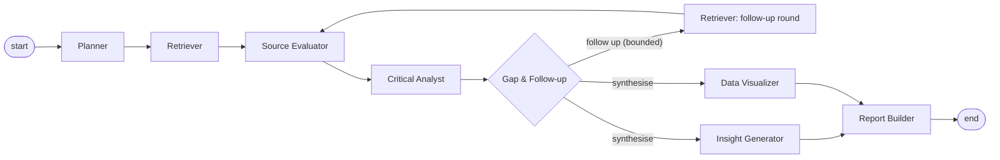

# Deep Researcher AI

A multi-agent research assistant for complex, multi-hop questions. A team of specialised agents plans an
investigation, searches web, academic and uploaded sources, weighs their credibility, extracts claims tied to exact
passages, surfaces contradictions, follows up on gaps within a fixed budget, and writes a cited report you can
export, reopen and question.

**Stack:** LangGraph (orchestration) · Streamlit (UI) · OpenRouter via the OpenAI SDK (optional LLM) ·
OpenAlex, Crossref, arXiv and Tavily (sources) · Pinecone (vector search, optional) · SQLite or Turso (storage) ·
LangSmith (optional tracing).

> **Read this first.** Demo mode uses a **synthetic, fictional** dataset and says so everywhere. A citation that
> passes validation is *traceable* to a source passage, which is not the same as *true*. Check important
> conclusions against the original sources.

## Contents

- [Highlights](#highlights)
- [Quick start](#quick-start)
- [Using the app](#using-the-app)
- [Demo mode and live research](#demo-mode-and-live-research)
- [Accounts, privacy and data](#accounts-privacy-and-data)
- [Configuration reference](#configuration-reference)
- [Deployment](#deployment)
- [How it works](#how-it-works)
- [Project structure](#project-structure)
- [Testing and CI](#testing-and-ci)
- [Known limitations](#known-limitations)
- [Troubleshooting](#troubleshooting)
- [Documentation](#documentation)

## Highlights

- **Eight cooperating agents** in a LangGraph workflow, with a bounded follow-up loop and two synthesis steps that
  run in parallel.
- **Evidence you can audit:** every claim keeps a verbatim quotation and its location; agreement counts
  *independent* sources only; contradictions are shown side by side.
- **Background runs:** research keeps going if you close the tab, refresh or switch devices. Reattach from
  **In progress**, or press **Stop & write report** to get a partial, cited report.
- **Private by default:** every run, document, question and activity entry belongs to one signed-in user.
- **Honest limits:** hard caps on rounds, searches, sources, time, LLM calls and tokens; unconfigured providers are
  reported as unavailable, never simulated.
- **Dark and light themes,** responsive down to phone width.

## Quick start

Requires Python 3.12 or newer (developed on 3.13).

```bash
uv venv --python 3.13                                    # or: python3.13 -m venv .venv
source .venv/bin/activate                                # Windows: .venv\Scripts\activate
uv pip install -r requirements.txt -c constraints.txt    # or: pip install -r requirements.txt -c constraints.txt

cp .env.example .env          # sets APP_ENV=local; add API keys here for live research
streamlit run app.py          # http://localhost:8501
pytest                        # offline test suite; no keys or network needed
```

With no keys at all, the app runs in local mode with the offline demo. Add `OPENROUTER_API_KEY` and
`TAVILY_API_KEY` for live research, and `.streamlit/secrets.toml` for sign-in (see
[Accounts](#accounts-privacy-and-data)).

**VS Code:** open this folder, select the `.venv` interpreter, then **Run and Debug → "Deep Researcher AI
(Streamlit)"**. Tests appear in the Testing panel.

## Using the app

| Page | What you do there |
|---|---|
| **Home** | Visitors see **Try Demo** and **Sign in**. Signed-in users get a question box that starts research directly, the agent team, an animated workflow diagram and recent investigations. |
| **Sign in** | Sign in or create an account with the configured providers (Google, Microsoft, email), or continue to the demo. |
| **Research workspace** | Choose **Live** or **Demo** (guests: demo only), write a question or pick a demo question, choose **Quick / Standard / Deep**, and set optional context, objectives, follow-up rounds, source types, dates, LLM use and documents. |
| **Agents in action** | Follow a run live: each agent's status, an activity timeline and a progress bar, with **Stop & write report**. For a finished run: the per-agent audit trail, budget usage, stopping decision, event log and search activity. |
| **Research results** | One investigation in tabs: **Overview**, **Evidence**, **Analysis**, **Insights**, **Charts**, **Full report** and **Ask** (follow-up questions answered from the run's evidence). **Export** (Markdown, HTML, PDF) and **Refine** are in the header. |
| **Research library** | Search, sort and filter your runs; open, follow or delete them; **My activity**; **Delete my data**. |
| **Update profile** | Optional display name and research details, visible only to you. |
| **Settings** | Capabilities, personal defaults and documents. Admins also manage models, providers, the search cache and usage by user. |

The left panel holds navigation, **New research**, runs **In progress**, recent research and your profile. Switch
the theme from the app menu (⋮ → Settings → Theme).

**Research depth presets:**

| Depth | Subquestions | Follow-up rounds | Max searches | Max sources | Time limit |
|---|---|---|---|---|---|
| Quick | 4 | 1 | 10 | 15 | 2 min |
| Standard | 5 | 2 | 24 | 30 | 4 min |
| Deep | 7 | 3 | 48 | 60 | 8 min |

The orchestrator also stops early when the evidence is sufficient or a round finds nothing new.

## Demo mode and live research

| | Demo mode | Live research |
|---|---|---|
| Who | Everyone (the only mode for guests) | Signed-in users |
| Questions | Three preselected questions | Any question |
| Sources | 27 bundled **synthetic** sources (`data/sample_research/corpus.json`) | OpenAlex, Crossref and arXiv (no key), Tavily web and news (`TAVILY_API_KEY`), your uploads |
| Network | None | Search APIs plus bounded fetching of public result pages |
| Agents | Deterministic | Deterministic, plus LLM planning, extraction, adjudication, insights and prose when `OPENROUTER_API_KEY` is set |
| Labels | Every source, reference and export says SYNTHETIC | Live, cached or uploaded origin shown per source |

The demo dataset only covers AI and enterprise software, so demo mode runs **only** these questions (defined in
`DEMO_QUESTIONS`, `src/models/research.py`). The server rejects any other demo question, because it would retrieve
unrelated sources and produce a misleading report.

1. *How will agentic AI transform enterprise software over the next five years?*
2. *Which emerging technologies could create new business opportunities in India?*
3. *What evidence supports or contradicts the claim that AI agents will replace traditional SaaS workflows?*

The dataset deliberately includes conflicting figures, a vendor press release reprinted as news, an outdated
forecast, opinion pieces, conflict-of-interest material and a prompt-injection attempt, so every analysis feature
has something to find.

## Accounts, privacy and data

**Roles.**

| | Guest | Signed-in user | Admin (`ADMIN_EMAILS`) |
|---|---|---|---|
| Demo research | ✅ | ✅ | ✅ |
| Live research, uploads, follow-up Q&A with LLM | — | ✅ | ✅ |
| History | This browser session only, deleted after 24 hours | Private and permanent | Private and permanent |
| Personal defaults and profile | — | ✅ | ✅ |
| App-wide models, providers, cache | — | — | ✅ |
| Usage by user | — | — | Counts only, never content |

Every database query is filtered by the signed-in user, so nobody can list, open, export or delete another user's
data, even by guessing a run id. **Research library → My activity** shows your sign-ins, runs, questions, exports and
uploads, and **Delete my data** removes everything you own, including your profile and account record.

**Sign-in.** The Sign in page shows one button for each provider configured in Streamlit Secrets: **Google**,
**Microsoft** and **email**. "Email" is a hosted OpenID Connect service (for example Auth0) that handles sign-up,
verification and password reset, so the app never sees a password. An account is created on first sign-in. Admin
rights also require the provider to report the email address as verified. Setup steps are in
[docs/deployment.md](docs/deployment.md#2-identity-providers).

**Local mode.** With `APP_ENV=local` and no sign-in configured, the app runs as one local administrator. Never use
local mode for a public deployment; in production the app refuses to start without sign-in.

**Storage.** Data goes to a local SQLite file (`data/research.db`) by default. On Streamlit Cloud that file is wiped
on every restart, so set `TURSO_DATABASE_URL` and `TURSO_AUTH_TOKEN` to use a hosted Turso database instead. The app
keeps a fast local replica and writes through to Turso, so history survives restarts and redeploys. Older
single-user databases are migrated automatically.

## Configuration reference

Local settings go in `.env` (git-ignored). In a deployment, put the same keys at the top of Streamlit Secrets, above
any `[section]`. Restart the app after changing them.

| Group | Variable | Default | Purpose |
|---|---|---|---|
| Environment | `APP_ENV` | `production` | `production` requires sign-in; `local` allows a single local admin (development only) |
| LLM | `OPENROUTER_API_KEY` | — | Enables LLM features; without it agents run deterministically |
| | `OPENROUTER_MODEL` | `openai/gpt-4o-mini` | Any OpenRouter model with JSON output; admins can override it in Settings |
| | `OPENROUTER_BASE_URL` | `https://openrouter.ai/api/v1` | API endpoint |
| | `LLM_TIMEOUT_SECONDS` | `60` | Per-request timeout |
| | `LLM_INPUT_USD_PER_MILLION`, `LLM_OUTPUT_USD_PER_MILLION` | `0` (unknown) | Model prices for cost estimates |
| Search | `TAVILY_API_KEY` | — | Live web and news search |
| | `PINECONE_API_KEY` | — | Enables vector search for live research: passages are embedded with Pinecone Inference and ranked by similarity. Without it, keyword search (BM25) is used. Demo mode always uses keyword search |
| | `PINECONE_INDEX`, `PINECONE_CLOUD`, `PINECONE_REGION`, `PINECONE_EMBED_MODEL` | `deep-researcher`, `aws`, `us-east-1`, `llama-text-embed-v2` | Index (created on first use) and embedding model |
| | `CONTACT_EMAIL` | — | Sent to OpenAlex and Crossref for polite API use (recommended) |
| | `HTTP_TIMEOUT_SECONDS` | `20` | Search and fetch timeout |
| Storage | `TURSO_DATABASE_URL`, `TURSO_AUTH_TOKEN` | — | Hosted Turso database; both required |
| | `APP_DB_PATH` | `data/research.db` | Local SQLite file |
| | `MAX_UPLOAD_MB` | `15` | Upload size limit |
| Accounts | `ADMIN_EMAILS` | — | Comma-separated admin addresses (must be verified by the provider) |
| Run execution | `MAX_CONCURRENT_RUNS` | `2` | Investigations executing at once per app process |
| | `MAX_ACTIVE_RUNS_PER_USER` | `1` | Queued plus running investigations per user |
| | `MAX_QUEUED_RUNS` | `10` | Queued plus running investigations overall |
| | `RUN_HEARTBEAT_SECONDS` | `15` | How often a running investigation proves it is alive |
| | `RUN_STALE_AFTER_SECONDS` | `120` | A run without a heartbeat for this long is marked failed |
| | `RUN_EVENT_FLUSH_SECONDS` | `1` | Batch window for saving progress events |
| Tracing | `LANGSMITH_TRACING`, `APP_API_TRACING`, `LANGSMITH_*` | off | See [docs/observability.md](docs/observability.md) |
| Diagnostics | `AUTH_DIAGNOSTICS` | `false` | Temporary sign-in configuration logging (no values) |

Sign-in settings (`[auth]`, `[auth.google]`, `[auth.microsoft]`, `[auth.email]`) live in
`.streamlit/secrets.toml` locally or in Streamlit Secrets when deployed. Start from
`.streamlit/secrets.toml.example`.

OpenRouter only handles language tasks; it is **not** used for search. Source discovery is done by the search
providers, which admins can toggle in **Settings**. Without Tavily, live mode still searches academic sources and
uploads, and the run log says so.

## Deployment

The app is designed for Streamlit Community Cloud. The short version:

1. Point the app at this repository with `app.py` as the entry point.
2. Paste your secrets (API keys, Turso, `APP_ENV = "production"`, `[auth]` and at least one provider) into
   **App settings → Secrets**, using TOML syntax.
3. Register `https://<your-app>.streamlit.app/oauth2callback` with each identity provider.
4. Verify with the hosted checklist.

The full guide, including a ready-to-fill secrets template, provider setup and the verification checklist, is in
[docs/deployment.md](docs/deployment.md).

## How it works



Pages never run research themselves. They submit a request to a background job runner and read live progress from
the database, which is why runs survive refreshes and can be followed from another device. The follow-up decision
is deterministic: research stops at the round limit, when the search, source or time budget runs out, when no gap is
worth pursuing, or when a round finds no new sources.

See [docs/architecture.md](docs/architecture.md) for components, agent contracts, the evidence model, run execution
and persistence.

## Project structure

```
app.py                  entry point: navigation, home pages, sidebar
app_pages/              Sign in, workspace, agents in action, results, library, settings, profile
                        (not named pages/, so Streamlit never falls back to legacy auto-navigation)
src/agents/             planner, retriever, source_evaluator, critical_analyst, gap_analyst,
                        insight_generator, data_visualizer, report_builder, qa
src/orchestration/      LangGraph graph, typed state with reducers, run budget
src/services/           research service, background job runner, run events, LLM client, observability
src/search/             provider interface; Tavily, OpenAlex, Crossref, arXiv, demo and upload providers; safe HTTP
src/ingestion/          PDF, text, Markdown and CSV extraction; location-preserving chunking
src/evidence/           evidence store (normalisation, deduplication, syndication) and citations
src/analysis/           text heuristics, claims and claim validation, evidence matrix, visualisation extraction
src/retrieval/          BM25 keyword index; Pinecone vector index and embeddings (live research)
src/reporting/          Markdown, sanitised HTML and PDF export
src/database/           schema, SQLite and Turso backends, owner-scoped repository
src/models/             Pydantic models: request and plan, evidence, run, profile, visualisation
src/ui/                 session state and identity, components and styling, brand assets, charts; views/ = result tabs
static/                 logo and hero image (served by Streamlit static serving)
data/sample_research/   synthetic demo dataset
scripts/                scan_secrets.py, check_deployment.py
tests/                  offline pytest suite (mocked providers, fake LLM, network blocked)
docs/                   architecture, deployment, security, observability, plans
```

## Testing and CI

`pytest` runs the offline suite (206 tests at the time of writing; `pytest --collect-only -q` shows the current
count). An autouse fixture **fails any test that touches the network**: providers use `httpx.MockTransport` and the
LLM is a fake client. Coverage includes question validation, planning, provider parsing, retries and rate limits,
SSRF blocking, document extraction, deduplication and syndication, claim and quotation integrity, the evidence matrix
and contradictions, citation validation, routing and budgets, durable runs and the job runner, multi-user isolation,
sign-in rules, profiles, exports, Q&A citations and prompt-injection handling.

GitHub Actions (`.github/workflows/ci.yml`) runs the same checks you can run locally:

```bash
python -m pip install -r requirements.txt -c constraints.txt
python -m pip check
ruff check .
pytest
python scripts/scan_secrets.py      # reports candidate locations only, never values
```

Workflows on pull requests from forks wait for a maintainer to approve them (**Checks → Approve and run**).

## Known limitations

- Without an LLM, analysis relies on wording cues: paraphrased agreement can be missed and some contradictions are
  false positives (they are labelled heuristic). With an LLM, each candidate contradiction is reviewed.
- Academic results are usually abstracts only; this is shown per source and in the report.
- Vector search applies only to live research and needs `PINECONE_API_KEY`. Demo mode and runs without a key use
  keyword search (BM25), so heavily paraphrased questions retrieve less well there. The similarity cut-off
  (`MIN_SIMILARITY` in `src/retrieval/vector.py`) is not yet tuned on real investigations.
- Full-text fetching is limited to six pages per round and skips non-HTML content. Scanned PDFs need OCR, which is
  not included.
- Charts come only from uploaded CSV rows; web and PDF tables are not converted yet.
- Cost figures are estimates from configured prices, not invoices. There are no per-user token or cost quotas.
- Interrupted runs (app or computer stopped mid-run) are marked failed; **Re-run** starts them again from the
  beginning rather than resuming them.

## Troubleshooting

| Symptom | What to do |
|---|---|
| "Authentication is required in production" | Add `[auth]` and at least one complete provider to Secrets, or set `APP_ENV=local` for private development. Set `AUTH_DIAGNOSTICS=true` to log which field is missing ([details](docs/deployment.md#troubleshooting-sign-in)). |
| Streamlit Cloud: "Invalid format: please enter valid TOML" | Quote every value (`KEY = "value"`), list each key once, and put plain keys above `[auth]`. |
| Google "redirect_uri_mismatch" | The `redirect_uri` in Secrets must exactly match one registered in Google Cloud, ending in `/oauth2callback`. |
| "Web search unavailable" | Set `TAVILY_API_KEY`, or rely on academic sources. |
| Live runs return few sources | Widen the date range, enable more providers, or choose Deep. |
| "LLM output rejected" in the log | The app fell back to deterministic logic for that step; try a stronger model in Settings. |
| "You already have an investigation in progress" | One active run per user by default. Open it from **In progress**, stop it, or wait. |
| A run stays "running" after the app stopped | It is marked failed once its heartbeat is older than `RUN_STALE_AFTER_SECONDS`. Live runs on other instances are left alone. |
| Theme switcher or menu missing | Check `toolbarMode` in `.streamlit/config.toml` (`viewer` keeps the theme switcher) and restart. |
| Start over locally | Delete `data/research.db` (and `data/turso-replica.db*` when using Turso). |

## Documentation

| Document | For | Contents |
|---|---|---|
| [docs/architecture.md](docs/architecture.md) | Engineers | Components, workflow, agents, evidence model, run execution, persistence, design decisions |
| [docs/deployment.md](docs/deployment.md) | Operators | Streamlit Cloud setup, secrets template, identity providers, Turso, verification checklist |
| [docs/security.md](docs/security.md) | Reviewers | Threat model, identity and access, data isolation, LLM and network controls, secrets |
| [docs/observability.md](docs/observability.md) | Operators | LangSmith tracing setup, reading traces and token counts, privacy |
| [docs/plans/run-execution.md](docs/plans/run-execution.md) | Engineers | Durable run execution design and roadmap |

**Roadmap:** resumable runs with checkpoints, optional plan review before research starts, hybrid BM25 plus
vector retrieval for demo mode, OCR, more providers (Semantic Scholar, news APIs), scheduled re-runs, and automatic model price
lookup.
