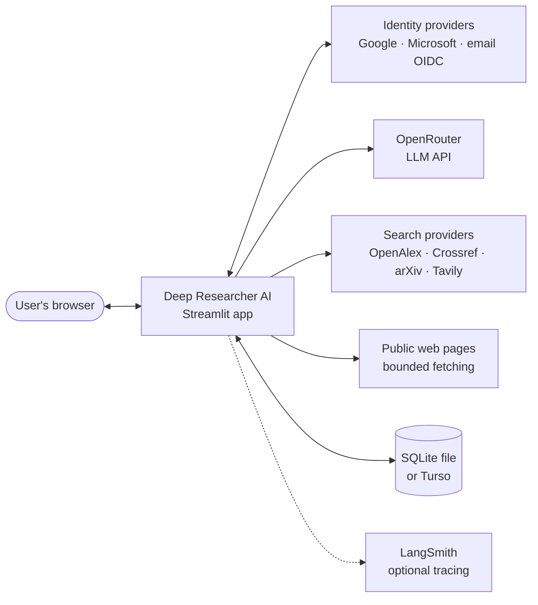
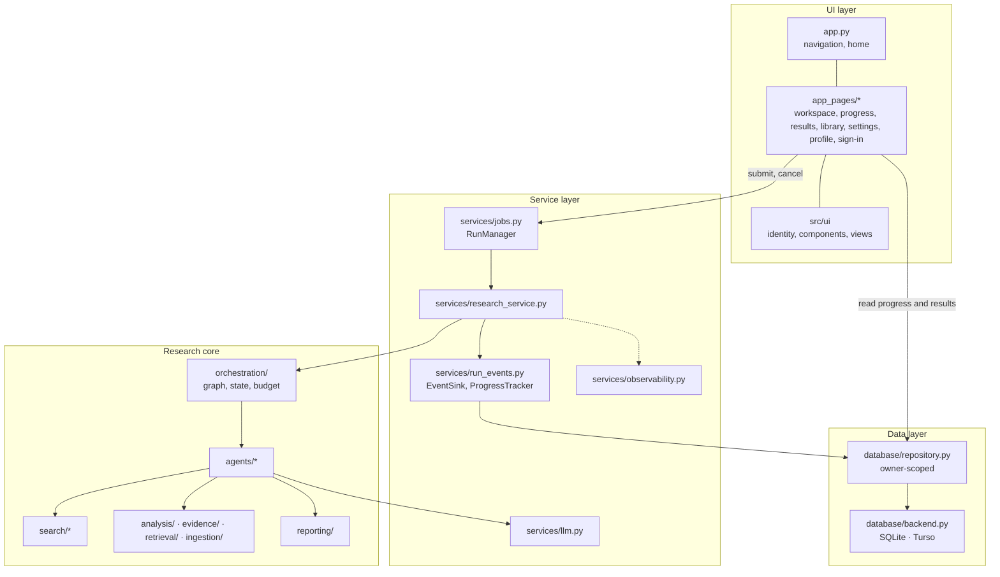
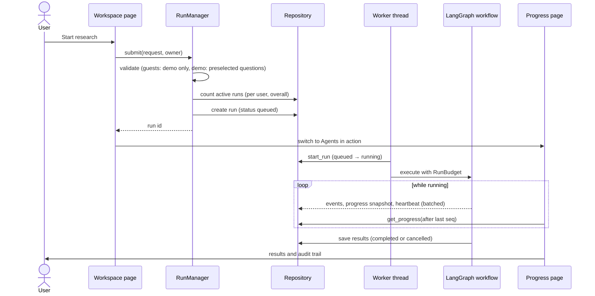
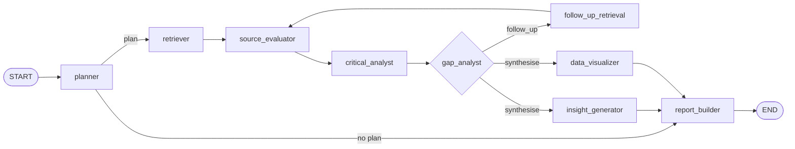
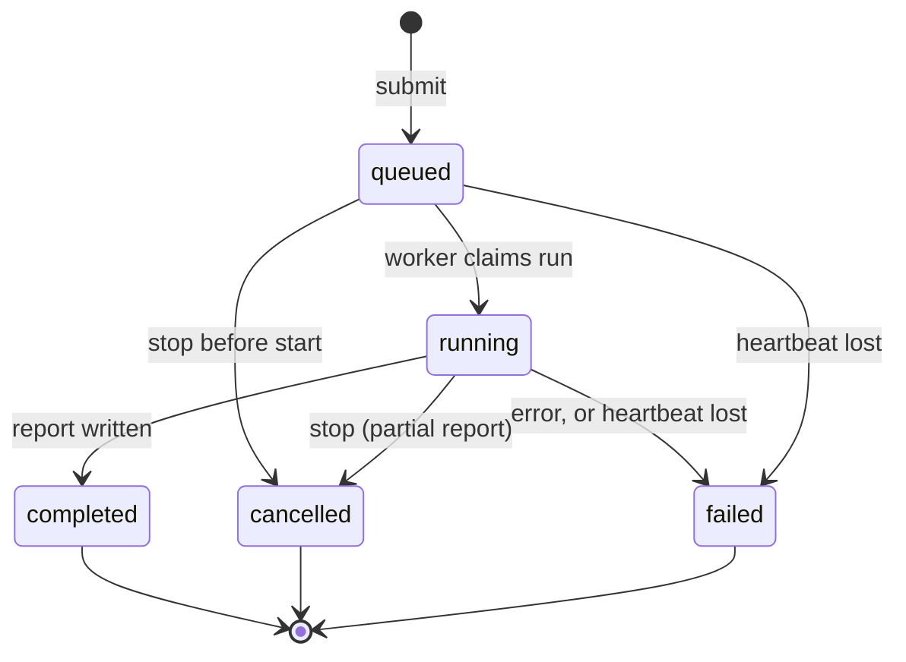

# Architecture

This document describes how Deep Researcher AI is built: its components, the research workflow, how runs execute
and persist, and the design decisions behind them. For setup see the [README](../README.md); for operations see
[deployment.md](deployment.md); for the security model see [security.md](security.md).

## Contents

1. [Design principles](#1-design-principles)
2. [System context](#2-system-context)
3. [Components](#3-components)
4. [Request lifecycle](#4-request-lifecycle)
5. [The research workflow](#5-the-research-workflow)
6. [Agents](#6-agents)
7. [Evidence model and integrity](#7-evidence-model-and-integrity)
8. [Run execution](#8-run-execution)
9. [Budgets and LLM use](#9-budgets-and-llm-use)
10. [Identity and multi-tenancy](#10-identity-and-multi-tenancy)
11. [Persistence](#11-persistence)
12. [User interface](#12-user-interface)
13. [Observability](#13-observability)
14. [Design decisions and trade-offs](#14-design-decisions-and-trade-offs)
15. [Constraints and future work](#15-constraints-and-future-work)

## 1. Design principles

1. **Deterministic control, LLM language.** Routing, deduplication, budgets, agreement counting, contradiction
   candidates and citation validation are plain, tested Python. The optional LLM plans, extracts claims, adjudicates
   contradictions, proposes insights and writes prose. Every LLM output is schema-validated and checked against the
   evidence, and a deterministic implementation is always the fallback.
2. **Provenance everywhere.** Every source records its origin (live search, cache, upload, demo), retrieval method
   and date, whether its full text was reviewed, and its limitations. Every claim keeps an exact quotation and
   location.
3. **Honesty over fluency.** Demo content is always labelled synthetic. Unconfigured providers are reported as
   unavailable, never simulated. Citation *traceability* is kept distinct from factual *verification*.
4. **Bounded.** Rounds, searches, sources, wall-clock time, LLM calls and tokens are capped per run; concurrent runs
   are capped per user and per process.
5. **Private by default.** All user data is owner-scoped at the repository layer, not just in the UI.

## 2. System context

The app is a single Streamlit process. It has no separate worker service: research runs in background threads
inside the same process, and all state that must outlive a browser session is written to the database.

## 3. Components

| Package | Responsibility |
|---|---|
| `app.py`, `app_pages/` | Navigation, pages and forms. Pages submit work and read state; they never run research. |
| `src/ui/` | Current user and roles, sidebar, styling (light and dark), brand assets, chart helpers, result-tab views. |
| `src/services/jobs.py` | Process-wide job runner: admission limits, queue, worker threads, cancellation, maintenance. |
| `src/services/research_service.py` | Validates a request, wires providers, budget and LLM, runs the graph and saves results. |
| `src/services/run_events.py` | Numbers, buffers and persists agent events with progress snapshots and heartbeats. |
| `src/services/llm.py` | OpenRouter client: JSON-schema calls, retries, budget reservations, untrusted-content wrapping. |
| `src/orchestration/` | LangGraph `StateGraph`, typed state and reducers, `RunBudget`. |
| `src/agents/` | The eight graph agents plus Research Q&A. |
| `src/search/` | Provider interface and implementations, search cache, SSRF-safe HTTP fetching. |
| `src/ingestion/` | PDF, text, Markdown and CSV extraction with location-preserving chunking. |
| `src/evidence/`, `src/analysis/`, `src/retrieval/` | Evidence store, claim extraction and validation, evidence matrix, contradictions, BM25, Pinecone vector search. |
| `src/reporting/` | Markdown, sanitised HTML and PDF export. |
| `src/database/` | Schema, migrations, SQLite and Turso backends, owner-scoped repository. |
| `src/models/` | Pydantic models for requests, plans, evidence, runs, profiles and charts. |

## 4. Request lifecycle

## 5. The research workflow

- **State** (`orchestration/state.py`) is a `TypedDict` of Pydantic objects: request, budget, plan, iteration,
  pending and searched queries, sources, passages, assessments, claims, evidence matrix, links, contradictions, gaps,
  insights, charts, report, agent statuses, usage and the route decision. The audit channels (events, search log,
  warnings, errors) use an append reducer, and `statuses` uses a merging reducer so parallel nodes each update only
  their own entry.
- **Routing** comes from `gap_analyst.decide_route`, a pure, unit-tested function. It returns *synthesise* when the
  round limit is reached, the search, source or time budget is exhausted, the run was cancelled, no gap has an
  expected value of at least 0.35, or the previous round found no new sources. Otherwise it returns *follow_up*
  with targeted queries for the most valuable gaps.
- **Plan adaptation:** the gap agent can add a subquestion to investigate a contested claim; the plan version and
  revision note are recorded.
- **Parallelism:** the Insight Generator and Data Visualizer are independent, so they run as parallel branches and
  the Report Builder waits for both. Within steps, searches in a round, page fetches and per-source claim
  extraction run in thread pools.
- **Failure handling:** each node is wrapped. An exception becomes an `errors` entry and a `failed` agent status,
  the evidence gathered so far is kept, and the run continues to a report that lists the error.

## 6. Agents

| # | Agent | Reads | Writes | LLM |
|---|---|---|---|---|
| 1 | Research Planner | request | plan, pending queries | Optional (validated `PlanDraft`) |
| 2 | Contextual Retriever | pending queries, sources | sources, passages, search log | No |
| 3 | Source Evaluator | sources, plan | assessments (relevance, credibility, freshness, flags) | No (transparent heuristics) |
| 4 | Critical Analyst | sources, passages, assessments, plan | claims, matrix, links, contradictions | Optional (verbatim-quote and integrity checks, contradiction adjudication) |
| 5 | Gap & Follow-up | plan, claims, matrix, budget | gaps, plan revisions, route, pending queries | No |
| 6 | Insight Generator | claims, matrix, contradictions | insights labelled observed, inferred or speculative | Optional (claim ids must exist) |
| 7 | Data Visualizer | CSV row metadata, passages, claims | charts, extraction notes | No (deterministic provenance checks) |
| 8 | Report Builder | everything | report and citation checks | Optional (prose rewrite; citation markers and numbers validated) |
| — | Research Q&A | stored run bundle | answer with citations | Optional (cited ids must be in the retrieved set) |

**Report structure.** The Report Builder follows a fixed flow: *Executive summary* (objective and bottom line
first), *Introduction* (objective, why it matters, scope and approach as tables), *Analysis* (by subquestion),
*Evidence overview* (claim matrix), *Findings* (key-findings table, trends, implications, risks), *Recommendations*
(numbered actions, each tied to its evidence), *Conclusion*, then *Limitations*, *Data behind the charts* and
*Sources*. Every section is built deterministically from the evidence; the optional LLM only rewrites the summary
and analysis in short, plain, neutral prose, and its rewrite is rejected if citations or numbers change.

## 7. Evidence model and integrity

- **Deduplication:** the same canonical URL (tracking parameters removed), DOI or document id, content hash, or a
  near-identical long title from the same publisher becomes one source. Source ids are stable hashes, so a source
  keeps its id across runs.
- **Syndication:** near-duplicate content from different publishers is kept but linked and flagged
  `repeats_other_source`. Agreement counts *independent groups*, so reprints never look like corroboration.
- **Claims:** heuristic extraction picks assertive sentences. LLM-proposed claims are accepted only if the quotation
  appears verbatim in a passage and the paraphrase does not add numbers or units, flip negation or drop forecast and
  uncertainty wording. The quotation remains the canonical text.
- **Evidence matrix:** claims are clustered by overlap of distinctive terms; majority polarity counts as supporting,
  minority as contradicting. Agreement levels are strong (3 or more independent sources), moderate (2), single
  source, mixed and contested.
- **Contradictions:** opposite polarity between independent sources, or numeric disagreement between comparable
  figures in similar context. Heuristic contradictions are labelled; with an LLM each candidate is reviewed and may
  be dismissed.
- **Citations:** sources are numbered in order of first use. Validation checks that the source exists, the
  reference matches the record, the cited passage is relevant to the sentence, and the marker renders. Invalid
  markers in LLM prose are removed, and prose that introduces numbers absent from the evidence is rejected.
- **Charts:** a series uses one source and one compatible unit, and each point resolves to an exact stored
  quotation. Duplicate labels, conflicting units, non-finite values and impossible percentages are rejected; missing
  values are omitted, never filled.

**Retrieval** has two rankers behind one interface. BM25 (`src/retrieval/bm25.py`) ranks passages in demo mode,
matches claims to subquestions, ranks evidence rows and insights, and is the fallback everywhere. For live
research with `PINECONE_API_KEY`, `src/retrieval/vector.py` embeds passages, uploaded sections and Q&A questions
with Pinecone Inference (`llama-text-embed-v2` by default) and ranks them by cosine similarity in Pinecone. Each
investigation has its own namespace (`run-<run id>`), and deleting a run deletes its namespace. Vectors store
only an id, a kind and a source id; passage text stays in the database. Passages from the source evaluator and
Q&A use vectors; a Pinecone error falls back to BM25 and is noted in the run's provider notes.

## 8. Run execution

- **One runner per process.** `RunManager` is created once with `st.cache_resource` and shared by every session. A
  fixed pool of `MAX_CONCURRENT_RUNS` daemon threads executes queued runs.
- **Admission.** `submit` validates the request, then checks `MAX_ACTIVE_RUNS_PER_USER` and `MAX_QUEUED_RUNS`
  against the database, so limits hold across instances sharing one database (best effort: two instances admitting
  at the same instant can briefly exceed a limit by one).
- **Claiming.** Workers move a run from `queued` to `running` with a conditional update, so a run cancelled, deleted
  or reaped while waiting never starts. The time budget starts at execution, not at submission.
- **Progress.** `EventSink` numbers each agent event, buffers it, and writes batches (every
  `RUN_EVENT_FLUSH_SECONDS` or 20 events) together with a progress snapshot and a heartbeat. A background heartbeat
  covers long, silent steps such as an LLM call. Pages read only events newer than the last one they saw.
- **Liveness.** A maintenance thread heartbeats this process's queued runs and periodically reaps runs whose
  heartbeat is older than `RUN_STALE_AFTER_SECONDS` (at least three missed heartbeats). Heartbeats are stored in
  **UTC**, so hosts in different timezones sharing one database agree on staleness.
- **Cancellation is cooperative.** A queued run is cancelled at once. For a running run the stop flag is stored and
  the budget is cancelled: no further searches or LLM calls, routing goes to synthesis, and the remaining agents
  write a partial report; the run ends `cancelled`. Another instance's stop request reaches the worker on its next
  progress write.
- **Interrupted runs fail.** A run interrupted by a crash of the app, its process or the computer stops
  heartbeating and is reaped as `failed` (at start-up and by the maintenance thread). A graceful app shutdown
  interrupts its budget instead of cancelling it, so those runs also end `failed`, not "stopped by you"; runs still
  waiting in the queue are failed at once. Closing the browser does not interrupt a run: it keeps running on the
  server. Every interrupted run records the same error and can be started again with **Re-run** (library, run log or
  results page), which submits the stored request as a new run; the failed run stays in the history.
- **Deletion safety.** Active runs cannot be deleted from the library. "Delete my data" stops them first, and a run
  deleted mid-execution is not re-created by its final save.

The design history is in [plans/run-execution.md](plans/run-execution.md).

## 9. Budgets and LLM use

- Each run has a `RunBudget` with limits from its depth preset: rounds, searches, sources, seconds, LLM calls and
  tokens.
- Every actual LLM request, including retries, uses one call from the allowance. Before a request, a conservative
  token allowance (prompt size, response limit, framing) is reserved under a lock, so parallel extraction calls
  cannot overshoot. Provider-reported usage replaces the reservation on success; failed requests and responses
  without usage keep an explicitly **unreported** allowance.
- LLM timeouts and retry waits are capped by the remaining run time. HTTP requests already in flight are bounded by
  their own timeouts rather than cancelled at the deadline.
- USD estimates use `LLM_INPUT_USD_PER_MILLION` and `LLM_OUTPUT_USD_PER_MILLION`; zero means unknown, not free.
- All retrieved and uploaded content, evidence matrices and report drafts are wrapped as untrusted data in prompts.
  See [security.md](security.md#4-llm-and-prompt-injection-controls).

## 10. Identity and multi-tenancy

- **Modes.** `APP_ENV=production` (the default) requires sign-in and stops before opening storage if it is missing
  or incomplete. `APP_ENV=local` without sign-in gives a single local administrator.
- **Identities.** Sign-in uses Streamlit's OpenID Connect support (`st.login`) with Google, Microsoft or a hosted
  email provider. The token's issuer must match a configured provider, otherwise the session is rejected. Account
  ids are the provider subject, namespaced by provider (Google subjects stay unprefixed for compatibility), so two
  issuers can never map to one account.
- **Roles.** Guests get a temporary per-session id (`guest:<random>`), demo mode only, and data purged after 24 hours.
  Signed-in users get live research, uploads and a permanent private history. Admins are signed-in users whose
  **verified** email is in `ADMIN_EMAILS`.
- **Isolation.** Every repository method that touches user data takes an owner id and filters by it; reads of
  another user's run return nothing rather than an error, so ids cannot be probed. The search cache is the only
  shared data.

## 11. Persistence

- **Backends.** `database/backend.py` offers a local SQLite file or Turso (hosted libSQL) through an embedded
  replica: reads are local and fast, writes go to Turso. Both expose the same small interface and return rows as
  dictionaries; column names are lower-cased because Turso upper-cases keyword-like names such as `plan`. Bulk
  saves use chunked multi-row inserts to limit network round trips.
- **Migrations** are additive and run on start-up: older single-user databases gain owner columns (existing data
  becomes the local user's), and newer columns (heartbeats, progress, charts) are added in place.

| Table | Scope | Contents |
|---|---|---|
| `users` | Per user | Profile from the identity provider, last login |
| `activity` | Per user | Sign-ins, runs, Q&A, exports, uploads, deletions |
| `settings` | App-wide and per user (`user:<id>:…`) | Admin settings, personal defaults, profile |
| `runs` | Per user | Request, plan, usage, statuses, summary, worker, heartbeat, progress, cancel flag |
| `sources`, `passages`, `assessments`, `claims`, `matrix_rows`, `evidence_links`, `contradictions`, `gaps`, `insights`, `charts`, `reports`, `events`, `search_log`, `qa_messages` | Per run | Evidence, analysis, report, audit trail and Q&A; deleted with the run |
| `documents` | Per user | Uploaded files: extracted sections and row metadata, unique per user and content hash |
| `search_cache` | Shared | Provider results, 24-hour lifetime |

## 12. User interface

- **Navigation** is defined in `app.py` with `st.navigation`. Pages live in `app_pages/`, deliberately not
  `pages/`, so Streamlit never switches to its legacy auto-navigation, which would bypass `app.py` (and with it
  sign-in, theme and sidebar) on deep links.
- **Live progress** uses `st.fragment(run_every=…)` to poll `get_progress`, so only the progress area reruns.
- **Theming.** `.streamlit/config.toml` defines light and dark themes; the custom CSS uses `light-dark()` colour
  pairs so it follows whichever theme the user picks. `toolbarMode = "viewer"` keeps the theme switcher while hiding
  developer options.
- **Static assets** (logo, hero image) are served from `static/` with `server.enableStaticServing`.
- **Safety in rendering.** User-controlled text inserted into HTML (names, questions, titles) is escaped.

## 13. Observability

`services/observability.py` adds optional LangSmith tracing: one `research-investigation` trace per run, with
agent spans and request spans for model calls, provider searches and HTTP operations. Context is copied into
worker threads explicitly. Inputs and outputs are hidden by default, and custom spans carry metadata only. Tracing
failures are isolated from research execution. Details are in [observability.md](observability.md).

## 14. Design decisions and trade-offs

| Decision | Why | Trade-off |
|---|---|---|
| Deterministic routing and validation; LLM only for language | Reproducible, testable behaviour; a working app without any API key | Heuristic analysis is less nuanced than an LLM |
| LangGraph for orchestration | Typed state, reducers, conditional edges and parallel branches; a path to checkpoints | Framework dependency; agents themselves stay framework-free (`agent.run(state, ctx)`) |
| In-process job runner instead of a worker service | Streamlit Community Cloud runs a single process with no separate workers | Runs stop if the process stops (they are marked failed and can be re-run from the start) |
| All progress in the database | Any session or device can reattach; limits work across instances | More writes; batched to keep Turso traffic low |
| BM25 for demo and as fallback; Pinecone for live research | Demo stays offline and deterministic; live runs handle paraphrase | Two rankers to keep consistent; live runs depend on a hosted service and its cost |
| Turso embedded replica | Persistent, shared storage on a free tier with fast local reads | Writes pay network latency to the database region |
| Owner checks in the repository | Isolation cannot be bypassed by a UI bug | Every query carries an owner id |
| Demo limited to three questions | The synthetic dataset covers one domain; other questions would mislead | Less freedom in demo mode |

## 15. Constraints and future work

- Interrupted runs are marked failed and re-run from the start; they are not resumed from where they stopped.
- Admission limits are best-effort across instances; there are no per-user token or cost quotas.
- Academic sources are mostly abstracts; scanned PDFs need OCR; charts come only from uploaded CSV rows.
- Hosted end-to-end verification (sign-in providers, persistence, tracing) is tracked in
  [deployment.md](deployment.md#6-verify-the-deployment).
